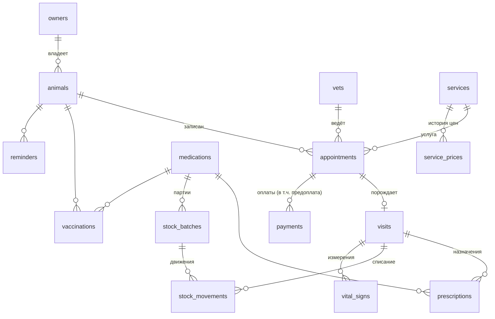

# Материалы для пояснительной записки

Тема: **Разработка АРМ диспетчера ветеринарной клиники.** Формат: десктопное приложение (PySide6), СУБД SQLite.

## 1. Предметная область
Клиника принимает владельцев с животными; диспетчер записывает их к врачам нужной специализации на свободные слоты,
фиксирует факт приёма (диагноз, назначения, вес/температура), списывает препараты со склада, принимает оплату и
следит за ревакцинациями. **Проблемы ручного учёта:** потеря истории приёмов и вакцинаций, двойные записи на одно время,
ошибки в остатках склада и расчётах, забытые ревакцинации и долги, ручная подготовка отчётов.
**Границы автоматизации:** в системе — запись, приём, склад, оплата, напоминания, отчёты. Вне системы — бухгалтерия
и налоги, онлайн-запись клиентами, интеграция с кассой и лабораторией.

## 2. Функциональные требования
| ID | Требование (проверяемое) |
|---|---|
| ФТ-01 | Диспетчер создаёт запись на приём: владелец по телефону → животное → услуга → врач → свободный слот; цена подставляется из действующего прайса |
| ФТ-02 | При выборе услуги список врачей ограничивается подходящей специализацией |
| ФТ-03 | Занятый слот врача недоступен для выбора; повторная запись на то же время отклоняется |
| ФТ-04 | Список записей фильтруется по периоду, статусу, врачу и поиску по животному/владельцу одновременно |
| ФТ-05 | Статус записи меняется только по допустимым переходам; недопустимые кнопки неактивны |
| ФТ-06 | Закрытие приёма создаёт приём, списывает препараты по FIFO, начисляет платёж «ожидает» — одной транзакцией |
| ФТ-07 | При нехватке препарата закрытие отменяется целиком с понятным сообщением |
| ФТ-08 | Приём оплаты (полной/частичной); сумма оплат не превышает стоимость приёма |
| ФТ-09 | Склад: приход, списание с причиной, подсветка просроченных и истекающих партий, фильтр «истекает в течение N дней» |
| ФТ-10 | Три отчёта с параметрами; выгрузка в XLSX с условиями отбора; пустой результат — «Данных нет» |
| ФТ-11 | Карточка животного: владелец, приёмы, вакцинации, назначения, оплаты, заметки, график веса |
| ФТ-12 | Напоминания генерируются по ревакцинациям и долгам без дублей |
| ФТ-13 | История цен услуг: новая цена добавляется версией, старые записи сохраняют прежнюю цену |

## 3. Пользовательские сценарии
**С-1 (полный процесс).** *Участник:* диспетчер. *Условия:* в справочниках есть врачи и услуги, на складе есть препарат.
*Шаги:* Ctrl+N → ввод телефона (новый владелец — «Создать владельца») → выбор животного, услуги, врача, даты и свободного
слота → «Записать» → «Подтвердить» → «Закрыть приём» (диагноз, назначение) → «Закрыть и начислить оплату» →
«Принять оплату». *Результат:* запись «завершён», остаток склада уменьшен, платёж «оплачен», долга нет.
*Ошибки:* слот занят; нет врача нужной специализации; не хватает препарата (откат); оплата больше суммы.

**С-2 (контроль ревакцинаций).** Отчёт «Проблемный» → список животных с просрочкой и долгом → «Напоминания» →
«Сгенерировать» → после звонка владельцу «Отметить выполненным». *Ошибки:* данных нет — метка «Данных нет».

**С-3 (склад).** «Приход» → препарат, серия, количество, срок → фильтр «истекает в течение 30 дней» → «Списание» с причиной.
*Ошибки:* списание больше остатка; пустая причина; серия с другим сроком годности.

## 4. Правила предметной области (и место проверки)
| № | Правило | Где проверяется |
|---|---|---|
| П-1 | Телефон владельца уникален и имеет формат +375XXXXXXXXX | БД: UNIQUE + CHECK; UI: регулярка |
| П-2 | Врач должен иметь специализацию, требуемую услугой | БД: триггер `trg_appt_specialization_*`; сервис; UI: фильтр врачей |
| П-3 | Слот врача уникален среди неотменённых записей | БД: частичный UNIQUE-индекс; сервис; UI: слоты |
| П-4 | Остаток партии не может стать отрицательным | БД: CHECK(qty>=0); атомарный `UPDATE … WHERE qty>=?` в транзакции |
| П-5 | Сумма платежей по записи ≤ стоимости записи; оплатить можно заранее (при записи) или в день приёма | БД: триггеры `trg_payment_limit_*`; сервис `accept_payment` |
| П-5а | По отменённой записи новая оплата невозможна; внесённая предоплата оформляется возвратом | БД: триггер `trg_payment_cancelled`; сервис `change_status` → `refund_prepayment` |
| П-5б | При закрытии приёма «ожидает» начисляется только на остаток, не покрытый предоплатой | Транзакция `close_appointment`, шаг (e) |
| П-6 | Завершённую и отменённую запись менять нельзя | БД: триггер `trg_appt_status_flow`; UI: неактивные кнопки |
| П-7 | Владельца/животное с историей приёмов удалить нельзя | БД: ON DELETE RESTRICT; репозиторий: понятное сообщение |
| П-8 | Просроченные партии не списываются на приёмах | Сервис `deduct_fifo` (expiry_date ≥ дата) |
| П-10 | Даты хранятся только как существующие календарные даты ISO | БД: CHECK `date(x) = x` (30 февраля отклоняется) |
| П-9 | Цена записи — снимок на момент записи; сумма оплат и долги считаются запросом, а не хранятся | Сервис + представления |

## 5. ER-диаграмма (концептуальная и логическая)

Связь «многие-ко-многим» врач–услуга решена атрибутом `services.required_specialization` (связь по специализации), а не
отдельной таблицей: достаточно одного правила соответствия.

## 6. Нормализация (до 3НФ)
* **1НФ:** атомарные значения; списки идентификаторов не хранятся — назначения, платежи, показатели вынесены в таблицы.
* **2НФ:** все таблицы имеют простой суррогатный ключ `id`; частичных зависимостей нет. Естественные ключи
  (`phone`, `(vet_id, date, time)`, `(medication_id, batch_no)`, `(service_id, valid_from)`) заданы UNIQUE.
* **3НФ:** транзитивных зависимостей нет: ФИО врача и кличка животного — только в `vets`/`animals`; цена услуги — в
  `service_prices`, а не в `services`. ФЗ примера: `appointments.id → (animal_id, vet_id, service_id, appt_date, appt_time)`;
  `animals.id → owner_id`, `owners.id → (full_name, phone)` — владелец не дублируется в записи.
* **Контролируемая денормализация:** `appointments.price_kopecks` — снимок цены на дату записи. Причина: смена прайса
  не должна менять смысл прошлых операций (п.5.4 ТЗ). Аномалия обновления исключена: поле не меняется после записи.
  Суммы оплат, долги, остатки по партиям не дублируются — считаются SQL (остаток партии хранится как `qty` и
  согласован с журналом `stock_movements`, оба изменяются только в одной транзакции).

## 7. История и удаление
* Цены: `service_prices` (версии с `valid_from/valid_to`, одна открытая версия на услугу — частичный UNIQUE-индекс).
* Справочники и участники (`owners`, `animals`, `vets`, `services`, `medications`, `stock_batches`, `payments`, `visits`
  → родитель) — **RESTRICT**: история нельзя потерять. Врача «архивируют» флагом `is_active=0`.
* Дочерние строки приёма (`prescriptions`, `vital_signs`) и сведения животного (`vaccinations`, `reminders`) —
  **CASCADE**: они не имеют смысла без родителя. `stock_movements.visit_id` — **SET NULL**: журнал склада сохраняется.

## 8. NULL, ноль и пустая строка
`NULL` — значение неизвестно/не применимо (диагноз ещё не поставлен, `valid_to` у текущей цены, вес не измерялся);
`0` — известное нулевое значение (цена 0 BYN допустима, остаток партии 0); пустая строка недопустима для обязательных
текстов (`CHECK(length(trim(x))>0)`), необязательные пустые значения сохраняются как `NULL`.

## 9. Допущения и известные ограничения
* Уникальность слота действует среди неотменённых записей (иначе отменённая запись навсегда блокировала бы время).
* `services.required_specialization` и `prescriptions.qty` добавлены к минимальному набору полей ради правила специализации и FIFO-списания.
* «Проблемный» отчёт: «просроченная ревакцинация И неоплаченный приём» реализован параметром режима: «любое из двух» (по умолчанию) или «оба сразу».
* Авторизация не реализована (пользователь — диспетчер); роль врача — вне границ текущей версии.
* Печать отчёта — через системный диалог печати; формы «Назначение» и «Счёт» — PDF (reportlab), шрифт с кириллицей берётся из системы.
* Известное ограничение: SQLite допускает одного писателя — длинные параллельные операции записи ждут до 5 с (`timeout`).

## 10. Тестовые случаи
Автоматизированные тесты: `tests/` (идентификаторы T-01…T-37 в docstring каждого теста: требование, шаги, ожидаемый результат).
Фактический результат — вывод `pytest -v` (статус PASSED/FAILED); скриншоты сообщений и отката сохраняются из UI-тестов T-33/T-34.

## Решение: платёж привязан к записи на приём (предоплата)
Изначально `payments.visit_id` ссылался на фактический приём (`visits`), который появляется только при закрытии записи,
поэтому оплатить заранее было невозможно. По требованию предметной области (клиент оплачивает сразу при записи
или в день приёма) внешний ключ перенесён на `appointments`: `payments.appointment_id → appointments.id (RESTRICT)`.
Нормализация не нарушена: `visits` и `appointments` связаны 1:1 (`visits.appointment_id UNIQUE`), сумма к оплате
по-прежнему не хранится, а считается запросом (`v_debt_visits`, `price_kopecks − Σ оплат + Σ возвратов`).
Сценарии: (1) запись → предоплата 100 % → закрытие: начисление не создаётся; (2) запись → частичная предоплата →
закрытие: «ожидает» на остаток; (3) запись → предоплата → отмена: автоматический «возврат».
Существующая БД старой версии обновляется автоматически при запуске (`db.migrate`, с резервной копией `*.bak-before-prepay`).
